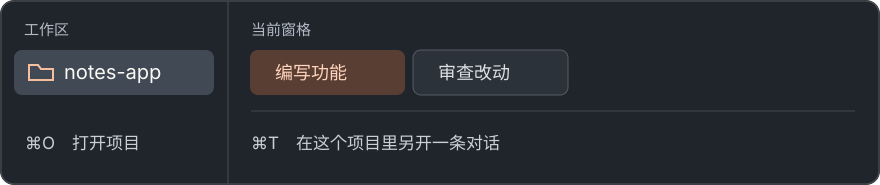

<h1 align="center">在 Mac 上稳健地使用 Claude Code</h1>

<p align="center">用自己的账号打开项目，在同一个工作区处理多个任务，也能查清一次请求走了哪条网络路径。</p>
<p align="center"><sub>macOS · cmux · Claude Code · MIT</sub></p>
<p align="center">
  <a href="#快速开始">快速开始</a> ·
  <a href="#日常快捷键">日常快捷键</a> ·
  <a href="docs/network.md">网络检查</a> ·
  <a href="docs/accounts.md">账号与续聊</a> ·
  <a href="#常见问题">常见问题</a>
</p>



## 快速开始

需要 macOS、zsh、Node.js 20 或更高版本（含 npm），以及已安装的 cmux 和 Claude Code。先运行 `claude auth status` 检查登录状态，需要登录时运行 `claude auth login`。[cmux 官网](https://cmux.com/) · [Claude Code 安装说明](https://code.claude.com/docs/en/setup)

**1. 下载项目，预览配置。** 选一个长期保留的位置，再执行：

```sh
git clone https://github.com/s840207702/claude-code-on-mac.git
cd claude-code-on-mac
./scripts/doctor.zsh
npm ci --ignore-scripts
npm run preview
```

**2. 应用配置。** 预览会列出将写入 `~/.config/cmux/cmux.json` 的动作。确认后执行：

```sh
npm run setup
```

**3. 打开第一个项目。** 回到 cmux，按 **⌘⇧,** 重载配置，再按 **⌘O** 选一个已有文件夹。看到左侧出现文件夹名、右侧出现 Claude 输入框，就可以开始工作了。

## 日常快捷键

| 想做什么 | 操作 | 会发生什么 |
| --- | --- | --- |
| 打开已有项目 | **⌘O** | 选文件夹，以文件夹名新建工作区，并在该目录启动 Claude。 |
| 新建工作区 | **⌘N** | 在另一个工作区启动 Claude。 |
| 同一项目另聊一个任务 | **⌘T** | 在当前窗格新增 Claude 标签，两条对话各自保存历史。 |
| 两个终端并排看 | **⌘D** | 分割窗格，需要 Claude 时在新终端输入 `claude`。 |
| 接上之前的对话 | `claude --resume` | 在原项目目录、原登录配置下选择已有记录。 |

## 网络与账号

| 想确认什么 | 从哪里开始 |
| --- | --- |
| Claude 实际走哪个出口？ | 发出一次正常请求，在代理日志里核对域名、命中规则和最终节点。[网络检查](docs/network.md) · [mihomo 分流示例](examples/claude-routing.yaml) |
| DNS 或浏览器 WebRTC 会暴露什么？ | 分别核对 DNS 上游和浏览器的公网候选地址，记录各自的测试条件。[DNS 与 WebRTC 检查步骤](docs/network.md#dns-解析) |
| 如何分开个人和工作账号？ | 为额外账号建独立登录配置，手动选择账号和会话。快捷键默认启动当前终端的 Claude。剩余 5% 时自动接力仍是本地实验。[账号与续聊](docs/accounts.md) |

## 常见问题

<details>
<summary><b>我已经自定义过 cmux 快捷键了，安装时会怎样？</b></summary>

先运行 `npm run preview`。如果目标配置已有不同的动作或检测到快捷键冲突，安装器会显示具体名称并停止写入。可以对照模板自行合并需要的部分。[cmux 配置模板](cmux/settings.json)

</details>

<details>
<summary><b>切换工作区或重启后，之前的对话去哪了？</b></summary>

切回工作区可以看到仍打开的标签。重启后由 cmux 恢复布局，自定义命令能否自动执行取决于恢复设置。要接着聊，在原项目目录和登录配置下运行 `claude --resume`。[cmux 恢复说明](https://cmux.com/docs/session-restore)

</details>

<details>
<summary><b>怎样撤销配置或移动仓库？</b></summary>

在仓库目录运行 `npm run undo`，然后回到 cmux 按 **⌘⇧,**。撤销会保留安装后手动修改的动作。选目录脚本使用绝对路径，因此移动仓库前先撤销，到新位置后重新预览、安装。

</details>

## 项目结构

| 位置 | 用途 |
| --- | --- |
| [cmux/](cmux/) | 快捷键模板与 macOS 文件夹选择器 |
| [scripts/](scripts/) | 配置预览、安装、撤销、环境检查与独立账号启动 |
| [docs/](docs/) 和 [examples/](examples/) | 网络与登录指南，以及可按需合并的分流规则 |
| [tests/](tests/) | 可在本机运行的隔离测试 |

## 验证

`npm test` 在临时目录检查安装、重复安装、撤销、配置冲突、项目选择和账号启动参数。测试使用模拟 Claude 命令。需要确认真实网络时，先用 `./scripts/doctor.zsh --network` 检查 API 域名连通性，再从 Claude 发起一次实际请求。

已检查的版本为 cmux 0.65.2、Claude Code 2.1.325 和 mihomo 1.19.33。[MIT 许可证](LICENSE)
